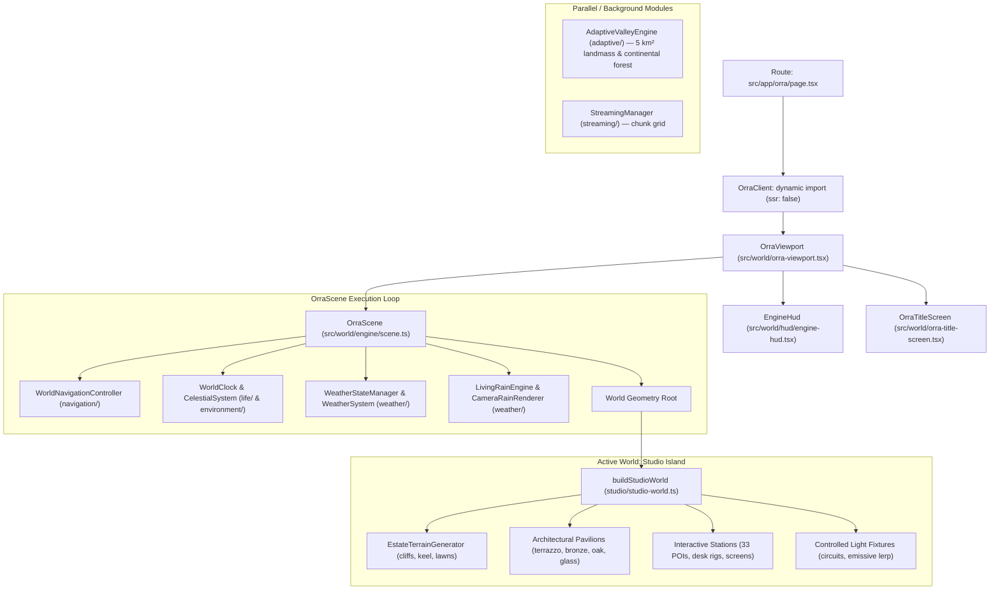

# ORRA World: Build Structure & Remodeling Guideline

> **Scope**: Authoritative architecture, structural hierarchy, subsystem contracts, and remodeling standards for the ORRA 3D spatial simulation (`src/world/`).

---

## 1. Architectural Overview & System Topology

The ORRA spatial engine is organized into clean, decoupled layers from Next.js route down to GPU draw calls:



---

## 2. Directory Structure & Subsystem Roles

| Directory | Core Responsibilities | Key Files |
| :--- | :--- | :--- |
| `src/world/engine/` | Renderer initialization, PMREM lighting, tone mapping, main render loop, lifecycle transitions. | `scene.ts`, `performance-profile.ts`, `world-scale.ts` |
| `src/world/studio/` | Current active world model: floating estate plateau, architecture, room suites, furniture, interactive stations. | `studio-world.ts`, `island.ts`, `stations.ts`, `rand.ts` |
| `src/world/terrain/` | Procedural landmass terrain, FBM heightfields, cliff extrusions. | `floating-landmass.ts` |
| `src/world/adaptive/` | Continental forest vegetation pipeline, tree archetypes, screen-space LOD, budget governor. | `valley-engine.ts`, `continental-forest.ts`, `continental-tree-archetypes.ts` |
| `src/world/navigation/` | Spherical orbital camera, inertia damping, terrain elevation raycasts, focus transitions. | `world-navigation.ts` |
| `src/world/weather/` | Weather state machine, 9-phase rain lifecycle, mist/fog, waterfalls, god rays. | `weather-system.ts`, `weather-world-state.ts`, `living-rain-engine.ts` |
| `src/world/environment/` | Celestial sun/moon orbits, dynamic atmospheric lighting, environmental sampling. | `celestial-system.ts`, `environmental-state.ts` |
| `src/world/space/` | Cosmic void background, starfield (2,800+ stars), tumbling asteroid belt. | `space-environment.ts`, `orbital-assets.ts` |
| `src/world/life/` | Simulation clock, diurnal cycle, seasonal vegetation transitions. | `world-clock.ts`, `seasons.ts`, `climate-weather.ts` |
| `src/world/hud/` | High-contrast OLED navigation dock, Weather drawer, Engine telemetry drawer. | `engine-hud.tsx`, `streaming-debug-hud.tsx` |

---

## 3. How the World is Currently Built

### 3.1 Initialization Sequence (`OrraScene.initializeWorld`)
1. **Renderer & Shading**: Configures `WebGLRenderer` with `logarithmicDepthBuffer: true`, `ACESFilmicToneMapping`, and throttled `PCFShadowMap`. Generates PMREM environment map from `RoomEnvironment` for realistic glass and metallic reflections.
2. **Phase 1: Forming Terrain**: Sets up base ambient (`ORRA_COLORS.violet`), hemisphere, and solar directional key lights.
3. **Phase 2: Placing Structures**: Calls `buildStudioWorld(this.studioRoot)`:
   - Evaluates spline boundary (`createOrganicPolygonShape`) and extrudes 12.5 m cliff profile.
   - Deforms mesh vertices using an inverted keel taper ($\approx 0.52\times$ base) and columnar rock noise.
   - Assembles architectural pavilions, floor plates, acoustic glass walls, and interior stations.
   - Binds lighting circuits into `lightControls` map for programmatic dimming.
4. **Phase 3: Synthesizing Atmosphere**:
   - Spawns `WeatherSystem`, `CameraRainRenderer`, and `SpaceEnvironment` (starfield + asteroid belt).
   - Synchronizes directional sunlight angles to the `CelestialSystem` solar arc.

### 3.2 Navigation & Pitch Clearance Invariants
Camera motion adheres to mathematical clearance rules (`src/world/navigation/world-navigation.ts`):
- **Pitch Angle Constraints**: Strictly clamped to $\phi \in [18^\circ, 82^\circ]$ ($[0.314, 1.431]\text{ rad}$) to prevent subterranean viewpoints and gimbal locks.
- **Target Elevation Ground Floor**: $T_y^* = \max(T_y, h(T_x, T_z) + 2.5\text{m})$.
- **Ground Clearance Buffer**: Minimum $4.0\text{m}$ altitude above surface geometry at all orbital radii.

---

## 4. Remodeling Strategy & Best Practices

### 4.1 Modularizing `studio-world.ts`
`src/world/studio/studio-world.ts` is currently a monolithic builder ($\approx 9{,}300$ lines). When remodeling:
1. **Split by Responsibility**:
   - `studio/terrain/`: Island cliff extrusion, keel shaping, underbelly stalactites, companion islets.
   - `studio/architecture/`: Shell structures, acoustic glass facades, terrazzo foundations, roof cantilevers.
   - `studio/interiors/`: Room suites (Executive, Engineering, Lab, Boardroom, Lounge), desk furniture, props.
   - `studio/lighting/`: Fixture definitions, lighting circuits, emissive materials, floor light pools.
2. **Preserve Component Contracts**: Maintain `WorldObjects` return type (`interactiveMeshes`, `stationPins`, `floorTags`, `lightControls`, `updateLighting`) to ensure seamless integration with `OrraScene` and `EngineHud`.

### 4.2 Resolving the Dual-Engine Split
Currently, two parallel world models exist:
- **Studio Island** (`src/world/studio/`): Flat floating estate focused on architectural pavilions and workplace stations (actively mounted in `OrraScene`).
- **Continental Valley** (`src/world/adaptive/`): Procedural FBM landmass with continental forest instancing (actively tested in `tests/world.test.ts` and `tests/forest-view-budget.test.ts`).

**Remodeling Rule**: Decide whether the world is:
- **A. Unified Archipelago**: The studio pavilion island sits as a primary landmark within or above the procedural valley landmass.
- **B. Clean Estate Focus**: Formally retire or isolate the legacy valley/streaming systems to avoid duplicate maintenance and memory overhead.

### 4.3 Rendering Budget & Performance Discipline
- **Instancing Over Individual Meshes**: Foliage, rocks, and repetitive architectural elements must use `THREE.InstancedMesh`.
- **Zero Unread Fields**: Adhere to `AGENTS.md §8.11.1`: any procedural state or attribute computed must reach GPU draw calls or be pruned.
- **Deterministic Procedural Generation**: Use integer hash `hash01(seed, salt)` (`src/world/math/hash.ts`), never unseeded `Math.random()`.
- **Transmission Restraint**: Keep glass on `MeshPhysicalMaterial` with calibrated `opacity` and `clearcoat`. Avoid expensive `transmission: 1` passes that degrade mobile and integrated GPU frame rates.

---

## 5. Verification & Testing Workflow

Before and after remodeling changes, execute the test suite and verify type safety:

```bash
# Run unit and integration tests
npm test

# Run specific world test suites
npx vitest tests/world.test.ts
npx vitest tests/estate-house.test.ts
npx vitest tests/continental-tree-archetypes.test.ts

# Type-check TypeScript
npm run typecheck # or npx tsc --noEmit

# Production build check
npm run build
```

---

## 6. Premeditated Next Steps for Remodeling

1. **Architecture Extraction**: Refactor `studio-world.ts` into discrete modules (`island-terrain.ts`, `pavilions.ts`, `stations-registry.ts`, `lighting-system.ts`).
2. **World Topology Alignment**: Confirm if the new approach integrates procedural terrain surrounding the studio or refines the floating estate model.
3. **Materials & Shading Pass**: Centralize material definitions (`terrazzo`, `bronze`, `oak`, `smokedGlass`) in a shared palette to eliminate duplicated material instances.
4. **Interactive Action Hooks**: Wire station clicks (`StudioObjectId`) to interactive UI cards or drawer states in `OrraViewport`.
