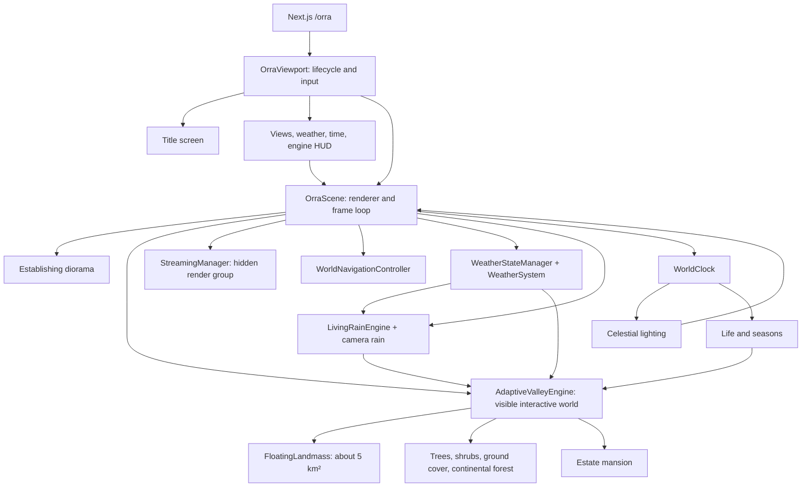

# ORRA — as-built system map

Source: `src/app/orra`, `src/world`, and `tests/world.test.ts`, inspected 2026-09-22. This maps running code, not aspirations or stale comments.

## Experience that exists today

- A separate cinematic entry diorama transitions to the interactive island. Visitors pan, orbit, zoom, double-click/double-tap to focus, or jump to the mansion, overhead or horizon views. Navigation state persists.
- The HUD controls clear/rain/fog, light/dark, time and rain phase, and displays telemetry. The frame loop updates sky lighting, weather, fog, god rays, rain, wetness, vegetation, seasons, a clean sky/void background.
- Raycasting changes camera focus, not object state. There is no general object-interaction grammar, on-foot traversal, functional workspace, or travel between island-planets yet.

## Connections and ownership

| Layer | Owns | Source |
| --- | --- | --- |
| React viewport | Input, controls, overlays, local state, scene lifecycle, 120 ms telemetry polling | `orra-viewport.tsx` |
| Scene | Three.js renderer, camera, entry composition, simulation ordering, frame loop | `engine/scene.ts` |
| Interactive world | Floating landmass, vegetation, ground cover, active destinations | `adaptive/valley-engine.ts` |
| Time and ecology | Clock, seasons, growth and vitality | `life/*` |
| Atmosphere | Preset authority, rain lifecycle, cloud/rain/fog visuals | `weather/*` |
| Light and environment | Celestial state, light colour/intensity, spatial environmental grid | `environment/*` |
| Void | Empty background outside the main island; `SpaceEnvironment` is retained in source but not mounted | `engine/scene.ts`, `space/space-environment.ts` |
| Camera | Orbit/pan/zoom, clearance, saved view and landmark perspectives | `navigation/world-navigation.ts` |
| Performance | DPR/shadows, vegetation caps, repack pacing, frame governor | `engine/performance-profile.ts`, `adaptive/*` |

`WorldClock` feeds celestial lighting and seasonal vegetation. The weather preset is precipitation authority; `LivingRainEngine` adds storm detail inside that envelope. Weather then influences vegetation motion, wetness, puddles, fog and light. The entry and interactive scenes are separate groups, not one continuous landscape.

## Important as-built distinctions

1. **Active destination:** The estate mansion is attached to the interactive root. Off-island precursor and crash-site geometry is no longer constructed or mounted. The tech portal office, district generator, towers, civic buildings and eco infrastructure remain constructed but detached; their objects still incur construction and lifecycle work.
2. **LOD ladder mostly dormant:** The interactive update fills full-detail tree meshes and sets simplified/impostor/canopy counts to zero. `dynamicScaleFactor` is calculated for telemetry but not used to select tiers; `ScreenSpaceLODCalculator` gets the camera but does not score instances. Actual adaptation chiefly uses culling, profile caps, DPR/shadows and repack pacing.
3. **Hidden parallel streaming:** `StreamingManager` is initialized and updated in interactive mode, but its group remains invisible. It covers the old 520 m radius while the main landmass is now about 5 km².
4. **Weather climate scheduler disconnected:** Manual presets work, but `climateWeatherEnabled` is never read by the frame loop and imported `resolveClimateWeather` is never called.
5. **Environmental grid lightly consumed:** It updates each frame and exposes `sampleEnvironment`, but world objects do not use that sample in the main loop.
6. **Loading is synchronous:** `initializeWorld` announces phases but does not yield between terrain, structure and atmosphere construction.
7. **Telemetry is not GPU profiling:** The governor reads requestAnimationFrame elapsed time; triangle figures are approximations, and GPU time/draw calls are not part of its decision.

## Mental model

ORRA is a rich **scene and simulation engine** centred on one visible island, but no common **interaction grammar** or **world-to-world topology**. The major architectural split is cinematic entry versus visible adaptive world versus invisible streaming world. The next design choice should start with what visitors can *do* in this universe, then define the visual language and rendering budget that make it convincing—without assuming any existing building is the goal.
